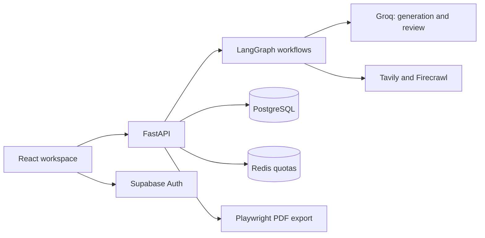

# Footnote

**Turn research questions into structured, source-backed reports.**

Footnote is an AI research workspace for students and knowledge workers. It combines web search, content extraction, and LangGraph workflows to research a topic, evaluate the resulting report, and refine it before delivery. A React interface streams progress as the work runs and lets you explore findings, request revisions, and export reports as PDFs.

## Features

- **Two research modes:** Normal research for a focused search-and-write workflow, and Deep Research for parallel investigation of sub-questions and follow-up research.
- **Citations and sources:** Review reports alongside the web sources used to produce them.
- **Quality review:** Normal reports are scored for relevance, depth, clarity, language, and formatting. Deep reports add claim verification and review for coverage, groundedness, coherence, contradiction handling, and depth.
- **Live progress:** Server-sent events (SSE) deliver research stages, evaluation scores, and chat output to the browser.
- **Report conversations:** Ask follow-up questions or request improvements. Review and approve proposed changes before saving a new report version.
- **Persistent workspace:** Revisit research sessions, chat history, and report versions stored in PostgreSQL.
- **PDF export:** Download reports rendered through Playwright and Chromium.
- **Authenticated access:** Supabase authentication, session ownership checks, encrypted user Firecrawl credentials, and Redis-backed per-user quotas.

## How it works



**Normal research:** Search → extract content → generate report → evaluate → revise until the quality threshold or iteration limit is reached.

**Deep Research:** Plan sub-questions → research in parallel → identify gaps and run follow-ups → write sections → merge → verify claims → evaluate and revise.

**Chat:** Classify the user's intent → answer a question or propose a report improvement → save approved revisions as report versions.

## Technology

| Layer | Tools |
| --- | --- |
| Frontend | React 19, Vite 8, Tailwind CSS 4, Framer Motion, Lucide |
| API | Python, FastAPI, Uvicorn, SSE |
| Orchestration | LangGraph, LangChain |
| Language models | Groq through `langchain-groq` |
| Search and extraction | Tavily, Firecrawl |
| Authentication | Supabase Auth and JWT verification |
| Storage | PostgreSQL, asyncpg, LangGraph PostgreSQL checkpoints |
| Quotas | Redis |
| PDF rendering | Playwright, Chromium, Markdown |

## Local setup

### Prerequisites

- Python 3.12, matching the backend container.
- Node.js 22.12 or newer in the Node 22 release line, and npm.
- A Supabase project with Auth enabled and the application's PostgreSQL schema provisioned.
- A Redis instance supporting Lua commands.
- Groq, Tavily, and Firecrawl API keys.

### 1. Clone and install

```sh
git clone https://github.com/anantjain-afk/Footnote.git
cd Footnote

python3.12 -m venv .venv
source .venv/bin/activate
python -m pip install -r requirements.txt
python -m playwright install chromium

cd frontend
npm ci
cd ..
```

On Linux, use `python -m playwright install --with-deps chromium` if Chromium's system dependencies are missing. The Docker image installs them automatically and uses the pinned Linux dependency set in `requirements.lock`.

### 2. Configure the backend

```sh
cp .env.example backend/.env
```

Edit `backend/.env` with your own credentials:

| Variable | Purpose |
| --- | --- |
| `GROQ_API_KEY` | Model inference and report evaluation. |
| `TAVILY_API_KEY` | Web search. |
| `FIRECRAWL_API_KEY` | Application extraction key; fallback for Normal mode. |
| `DATABASE_URL` | Server-only PostgreSQL connection string. |
| `SUPABASE_URL` | Supabase project URL; must match the frontend project. |
| `SUPABASE_JWT_SECRET` | Required only for legacy HS256 access tokens. ES256/RS256 tokens use the project's public signing keys. |
| `REDIS_URL` | Native Redis connection URL, such as `redis://localhost:6379/0`; use `rediss://` for a hosted TLS connection. |
| `FIRECRAWL_KEY_ENCRYPTION_KEY` | Stable Fernet key used to encrypt users' saved Firecrawl credentials. |
| `CORS_ORIGINS` | JSON array of allowed frontend origins, such as `["http://localhost:5173"]`. |

Generate the encryption key once, then copy the output into `backend/.env`:

```sh
python -c 'from cryptography.fernet import Fernet; print(Fernet.generate_key().decode())'
```

Keep this key stable: replacing it makes previously saved Firecrawl credentials unreadable. Backend settings load from `backend/.env`, rather than a root `.env` file. Keep provider keys, database credentials, and the encryption key on the backend.

### 3. Prepare the database and authentication

**Database prerequisite:** This repository currently contains incremental schema updates, rather than a complete fresh-database bootstrap. `update_schema.py` expects existing application tables, including `research_sessions`, `reports`, and `report_sources`. Provision the baseline schema from an existing installation before running the updates below.

1. Set `DATABASE_URL` to the provisioned database. For a Supabase pooler connection, use session mode on port `5432`; the current clients are configured for session pooling.
2. From the repository root, run `python update_schema.py` to add session/source metadata and report version storage. Confirm that it prints `Schema updated successfully.`
3. Apply [the user settings migration](migrations/20261008_firecrawl_user_settings.sql) in the Supabase SQL Editor.
4. LangGraph initializes its checkpoint tables when a checkpointed workflow first runs. After all referenced tables exist, apply [the browser access restriction migration](migrations/20261019_restrict_browser_table_access.sql). This migration expects every listed table to exist, including the checkpoint tables and `groundedness_results`.
5. In Supabase Auth, set the local Site URL to `http://localhost:5173` and add it to the allowed redirect URLs. If you use `http://127.0.0.1:5173`, configure that origin in both Supabase and `CORS_ORIGINS` as well.
6. Enable email authentication. Google sign-in additionally requires a Google OAuth client configured in Supabase's Google provider settings, using your project's `/auth/v1/callback` URL.

Application data is accessed through FastAPI using the server's database connection. The frontend uses Supabase for authentication.

### 4. Configure the frontend

Create `frontend/.env`:

```dotenv
VITE_BACKEND_URL=http://localhost:8000
VITE_SUPABASE_URL=https://YOUR_PROJECT_REF.supabase.co
VITE_SUPABASE_ANON_KEY=YOUR_SUPABASE_PUBLIC_KEY
```

`VITE_SUPABASE_ANON_KEY` accepts the project's public anon key or a publishable key. All `VITE_` values are included in the browser build; use public credentials only. Set the backend URL without a trailing slash and restart Vite after changing these values.

### 5. Start the application

Start Redis if you are using a local instance, then run the backend from the repository root:

```sh
source .venv/bin/activate
uvicorn backend.main:app --reload --port 8000 --workers 1
```

In a second terminal:

```sh
cd frontend
npm run dev
```

| Service | Local address |
| --- | --- |
| Web application | http://localhost:5173 |
| API | http://localhost:8000 |
| Interactive API documentation | http://localhost:8000/docs |
| Redis readiness check | http://localhost:8000/health/ready |

## Using Footnote

1. Sign up, confirm your email if required, and sign in.
2. Enter a research topic and choose **Normal** or **Deep research**.
3. For Deep Research, first save your own Firecrawl key under **Settings → API Keys**. The application key alone does not enable this mode.
4. Follow the live progress, then review the report and its sources.
5. Ask questions in chat, request improvements, and approve revisions you want to save.
6. Browse previous sessions or export a report as a PDF.

## API overview

Application endpoints require an `Authorization: Bearer <Supabase access token>` header. The root and readiness endpoints are public.

| Method | Endpoint | Purpose |
| --- | --- | --- |
| `GET` | `/` | API liveness. |
| `GET` | `/health/ready` | Redis quota-store readiness; does not check every dependency. |
| `POST` | `/api/sessions` | Start research with `topic` and `mode` (`normal` or `deep_research`). |
| `GET` | `/api/sessions` | List the current user's recent sessions. |
| `GET` | `/api/sessions/{id}` | Retrieve a session, report, and sources. |
| `GET` | `/api/sessions/{id}/stream` | Stream research progress through SSE. |
| `DELETE` | `/api/sessions/{id}` | Delete a session. |
| `GET`, `POST` | `/api/sessions/{id}/chat` | Retrieve chat history or send a message. |
| `POST` | `/api/sessions/{id}/chat/stream` | Stream a chat response. |
| `GET` | `/api/sessions/{id}/report/versions` | Retrieve report version history. |
| `POST` | `/api/sessions/{id}/report/versions/approve` | Save an approved report revision. |
| `POST` | `/api/report` | Generate a report synchronously without the session workflow. |
| `POST` | `/api/report/export` | Export report Markdown and sources as a PDF. |
| `GET`, `POST` | `/api/user/settings` | Inspect key status or save a Firecrawl key. |
| `DELETE` | `/api/user/settings/firecrawl` | Remove the saved Firecrawl key. |

See `/docs` on the running backend for request schemas and response details.

## Development checks

Run backend tests from the repository root with the virtual environment active:

```sh
python -m unittest discover -s backend/tests -p 'test_*.py' -v
```

Redis integration tests start an isolated local `redis-server` when available. Alternatively, set `REDIS_SERVER_BINARY` or `REDIS_TEST_URL` to a dedicated test instance; these tests skip if neither is available.

Run frontend checks:

```sh
cd frontend
node --test tests/*.test.mjs
npm run lint
npm run build
```

## Deployment

The repository includes a [Dockerfile](Dockerfile) for the backend and a [Render blueprint](render.yaml). Build the frontend separately with `npm run build` from `frontend/` and publish `frontend/dist/` to a static host.

```sh
docker build -t footnote-api .
docker run --rm --env-file backend/.env -p 10000:10000 footnote-api
```

For this container command, database and Redis URLs must be reachable from inside Docker. Container `localhost` refers to the container itself.

Set the deployed frontend's three `VITE_` variables before building. Update backend `CORS_ORIGINS` and Supabase Auth's site/redirect URLs to the deployed frontend origin. Review the blueprint's branch and environment settings for your installation.

**Run one backend instance with one Uvicorn worker.** Research uses FastAPI background tasks and process-local SSE queues. Redis shares quota state; research execution and live progress remain tied to the backend process, so restarts can interrupt active work.

Default quotas allow **10 reports** and **30 chat messages** per user in a rolling **3,600-second** window. Configure `RATE_LIMIT_REPORTS`, `RATE_LIMIT_CHAT`, `RATE_LIMIT_WINDOW_SECONDS`, and an environment-specific `RATE_LIMIT_KEY_PREFIX` as needed. Exhausted quotas return `429` with `Retry-After`; unavailable Redis returns `503` for generation and chat.

## Project structure

```text
Footnote/
├── backend/
│   ├── api/                # Sessions, chat, exports, and user settings
│   ├── core/               # Configuration, auth, database, SSE, and quotas
│   ├── graph/
│   │   ├── research/       # Normal research workflow
│   │   ├── deep_research/  # Planning, parallel research, verification, and review
│   │   └── chat/           # Intent routing, answers, and proposed improvements
│   ├── services/           # Provider clients, report versions, and PDF rendering
│   ├── tests/              # Backend tests and browser checks
│   └── main.py             # FastAPI entry point
├── frontend/
│   ├── src/                # React components, API clients, hooks, and auth context
│   └── tests/              # Event-stream and API-error tests
├── migrations/             # Incremental PostgreSQL migrations
├── .env.example            # Backend environment template
├── Dockerfile              # Backend image with Chromium
├── render.yaml             # Render service configuration
├── requirements.txt        # Python dependency constraints
├── requirements.lock       # Pinned Linux deployment dependencies
└── update_schema.py        # Updates an existing application schema
```

## Troubleshooting

| Issue | Check |
| --- | --- |
| Backend fails at startup | Confirm provider settings in `backend/.env` and that `DATABASE_URL` is valid and reachable. |
| Generation or chat returns `503` | Check `REDIS_URL`, Redis connectivity, and `/health/ready`. |
| Sign-in is unavailable or API requests return `401` | Confirm the frontend's public key and URL match the backend's Supabase project and that the access token is valid. |
| Deep Research asks for an API key | Save a personal Firecrawl key in Settings and configure the backend encryption key and users migration. |
| PDF export fails | Install Playwright Chromium and its platform dependencies. |
| Progress does not stream | Use one backend worker and instance, and ensure your proxy forwards SSE without buffering. |
| Requests fail after changing the frontend origin | Update `CORS_ORIGINS` and Supabase redirect settings, then restart the affected services. |
